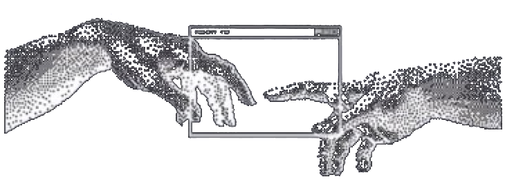
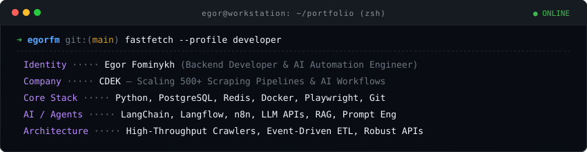
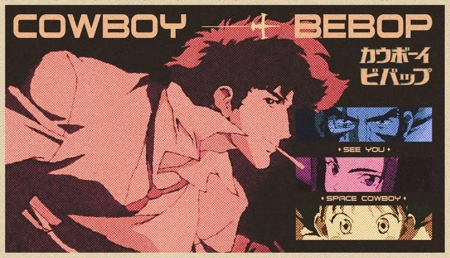

  <!-- Dithered Retro Header Banner -->
  

    

  <!-- Hero Titles -->
  <h1>Hi 👋, I'm Egor</h1>

  <h3>Backend Developer &amp; AI Automation Engineer</h3>

  
<i>Building robust backend architectures, high-scale data crawlers, and intelligent autonomous workflows.</i>

   

  <!-- Clean Obsidian Social Badges -->
  
  &nbsp;
  
  &nbsp;
  

 

---

### 🚀 About Me

<table>
  <tr>
    <td width="65%" valign="middle">
      

        I'm a <b>Python Backend &amp; AI Engineer</b> with hands-on commercial experience at the intersection of scalable backend systems, automated data extraction, and AI agent orchestration.
      

      

        Currently at <b>CDEK</b>, I engineer and maintain a distributed crawling infrastructure with <b>500+ scraping profiles</b> built on Python and Crawlab — continuously gathering pricing, stock, and catalog intelligence at scale.
      

      

        Alongside data systems, I design and deploy autonomous <b>AI workflow pipelines</b> using <b>LangChain, Langflow, n8n</b>, and modern <b>LLM APIs</b>, bridging real-world business logic with machine intelligence.
      

      

        With a solid background in <b>QA &amp; performance engineering</b>, I place high emphasis on test coverage, clean system design, and zero-downtime reliability.
      

    </td>
    <td width="35%" align="center" valign="middle">
      
    </td>
  </tr>
</table>

 

---

### 🖥️ System Terminal

  

 

---

### 💻 Tech Stack

  <!-- Core & Languages -->
  

    
  

  <!-- Categorized Minimalist Badges -->
  

    <!-- Backend & Data -->
    
    
    
    
    
    
  

  

    <!-- Web Scraping & Crawling -->
    
    
    
    
    
  

  

    <!-- AI & Automation -->
    
    
    
    
    
    
  

 

---

### 📊 GitHub Activity &amp; Statistics

  <table border="0">
    <tr>
      <td valign="middle" align="center">
        
      </td>
      <td valign="middle" align="center">
        
      </td>
    </tr>
  </table>

   

  

 

---

  

    

  <i>✦ SEE YOU SPACE COWBOY... ✦</i>
   
  カウボーイビバップ • Built with clean code &amp; continuous learning

